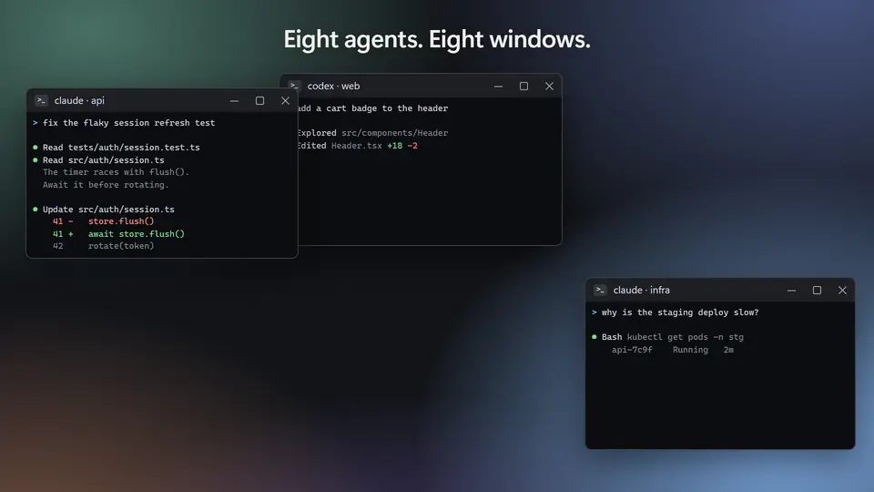

<div align="center">
  
  <h1>WindowDock</h1>
  <p><strong>Your windows. One workspace.</strong></p>

  

  <p>Running several AI agents leaves you with a pile of terminal windows to find, move, and minimize one at a time.<br>WindowDock brings independent terminals, AI agents, and desktop apps into compact, named tabs.</p>

  <a href="https://github.com/poikilometis/WindowDock/releases/latest"></a>

  [](https://github.com/poikilometis/WindowDock/actions/workflows/ci.yml)
  [](https://github.com/poikilometis/WindowDock/actions/workflows/release.yml)
  [](https://github.com/poikilometis/WindowDock/releases)
  [](#requirements)
  [](#build-from-source)
  [](#architecture)
  [](#languages)
  [](LICENSE)

  [Quick start](#quick-start) · [Documentation](#documentation) · [Report a bug](https://github.com/poikilometis/WindowDock/issues/new/choose)
</div>

---

WindowDock groups **existing application windows** into a single workspace. Keep several agent sessions visible, enlarge the one you are working with, and move or minimize the group together. Each application continues to run in its own process.

**Native window docking currently supports Windows x64.** The shared core and Avalonia interface are portable; Linux and macOS window backends are [planned](docs/ROADMAP.md).

## Why WindowDock?

- **Collect windows in one action.** Capture rules route matching windows. The rest fill the current tab and its overflow tabs. Right-click **Collect windows** to filter by name, include minimized windows, or inspect the last result.
- **Keep text readable.** Choose a grid, a main window with smaller panels, or a stack with an optional pinned panel. Split individual areas to build and save a custom layout.
- **Focus without losing context.** Double-click a panel header to enlarge it inside its tab. Return to the grid with one click.
- **Organize freely.** Drag one panel onto another to swap their positions. Moving across tabs fills the first empty position. Rename, search, select several panels, and undo supported actions.
- **Restore groups and projects.** Reconnect running windows. Opt in to reopening projects, resuming saved agent conversations, and opening the Windows Terminal layout when WindowDock starts.
- **Find and capture similar windows.** Search both docked panels and desktop windows with `Ctrl+Alt+K`. Use the executable path or a project folder reported by hooks to narrow capture rules. Exclusions take priority.
- **Open project workspaces.** Preview which windows will reconnect and optionally start missing commands. Link an existing panel to a saved command from its menu.
- **See what needs attention.** The bell shows waiting and failed agent sessions across all tabs. Open the exact panel from the list or enable Windows notifications in **View**.
- **Use multiple displays.** Open tabs in separate windows and bind them to Windows virtual desktops. Each tab remembers its last active panel.
- **Keep difficult windows handy.** Link a fullscreen or incompatible app in its original window and open it from a panel or search result.
- **Stay compact.** A 30-DIP command row and 22-DIP panel headers leave room for your applications. Hover scrolling routes the wheel without deliberately changing keyboard focus, where the target app supports it.

## Quick start

1. Download the Windows x64 portable ZIP from [Releases](https://github.com/poikilometis/WindowDock/releases/latest).
2. Extract **the whole archive** into a folder you can write to, then run `WindowDock.exe`. Keep its runtime, language folders, and other files together.
3. Choose **Add windows** to pick applications, or **Collect windows** to distribute visible desktop windows across tabs.
4. Double-click a panel header to zoom it. Drag the header to change its position or move it to another tab.
5. Open **…** for layouts, appearance, capture rules, projects, integrations, and group restoration.

> [!NOTE]
> **First launch.** `WindowDock.exe` is not code-signed yet, so Microsoft Defender SmartScreen may show “Windows protected your PC”. Choose **More info**, then **Run anyway**. To check the archive before you extract it, compare the output of `Get-FileHash` with the `.sha256` file published beside it.

Closing WindowDock returns the docked windows to the desktop. It does not end their sessions. Back up the `data` folder before upgrading, close WindowDock, then replace the program files without overwriting your data.

### Requirements

- Windows x64 with a graphical desktop. The current build is exercised on Windows 11; compatibility with individual third-party apps varies.
- The portable distribution includes .NET 10. No separate .NET installation is needed to run that distribution.
- Run WindowDock and the applications you dock at matching privilege levels. Prefer a normal, non-administrator session.

<details>
<summary><strong>Shortcuts and mouse actions</strong></summary>

| Action | Shortcut |
| --- | --- |
| Switch to tabs 1–9 | `Ctrl + Alt + 1…9` |
| Zoom active panel / return | `Ctrl + Alt + Enter` |
| Add open windows | `Ctrl + Alt + A` |
| Search all workspaces | `Ctrl + Alt + K` |
| Undo | `Ctrl + Alt + Z` |
| Minimize / show group | `Ctrl + Alt + D` / `Ctrl + Alt + G` |
| Show or minimize the group | `Ctrl + Alt + Space` |
| Return to the previous active window | `Ctrl + Alt + B` |
| Go to the next agent needing attention | `Ctrl + Alt + J` |
| New tab while the shell has focus | `Ctrl + N` |
| Search while the shell has focus | `Ctrl + K` |
| Cancel a drag or close a settings page | `Esc` |
| Zoom panel / return to grid | Double-click its header |
| Select multiple panels | `Ctrl` / `Shift` + click headers |

Edit the default bindings in **View → Global shortcuts**. Windows may reserve a shortcut or another app may have registered it first. The settings list shows unavailable bindings.

</details>

## Day-to-day workflows

| When you want to… | Use this |
| --- | --- |
| Find the agent that needs a reply | Set up its project hooks, then open the bell in the toolbar. Select a session to focus its window, or use `Ctrl + Alt + J` to jump to the next one. Turn on **View → Agent notifications in Windows** for alerts in the background. |
| Reopen a project | Select it in **… → Projects** and review the matches. Keep the running windows and choose whether to start missing commands. Use **Link to project command** in a panel menu to identify an existing window. |
| Collect only the windows you need | Right-click **Collect windows → Collect with filters**. Filter by title or application, limit the list to terminals, or include minimized windows. **Last collection results** shows each outcome. |
| Work on a smaller screen | Choose **Layout → Adaptive grid**. It switches to a stack when the tiles would exceed the available height. Use a panel’s **Pin beside the stack** action to keep a second window visible when there is room. |
| Move the group to another screen | Choose **View → Move WindowDock to display**. WindowDock remembers its placement for each display setup. |
| Put the windows back on the desktop | Choose **… → Return all windows and pause capture**. The returned applications keep running. |

Agent status comes from configured hooks. Sessions in a shared Windows Terminal window appear separately. Assign each session a uniquely named terminal tab and, if needed, a pane in **Agent integrations → Sessions**. The bell and `Ctrl+Alt+J` use that assignment.

### Arrange tabs and displays

- In a panel's **… → Split area** menu, add an area to the right or below. Add a window to the new area or drag another panel into it. Drag the dividers to size the areas. Select **Layout → Custom layout** to return to the saved splits after using another layout.
- Right-click a WindowDock tab and choose **Open tab on display**. Its separate window retains live input and can stay open while the main window is minimized. A bound display that disconnects makes the tab available in the main window again.
- To bind a tab to a virtual desktop, open WindowDock on that desktop and select **Bind to this virtual desktop** from the same menu. Use Windows Task View to switch desktops.

## Languages

The interface follows your **OS display language at startup**. Unsupported languages fall back to English. Number and date formats continue to follow your regional preferences. Existing tab names, panel aliases, and project names are your data and are not translated.

| Language | Resource code | Examples |
| --- | --- | --- |
| English | `en` | `en-US`, `en-GB` |
| Русский | `ru` | `ru-RU` |
| Español | `es` | `es-ES`, `es-MX` |
| Tiếng Việt | `vi` | `vi-VN` |
| 繁體中文 · Traditional Chinese | `zh-Hant` | `zh-TW`, `zh-HK`, `zh-MO` |
| 简体中文 · Simplified Chinese | `zh-Hans` | `zh-CN`, `zh-SG` |
| ไทย | `th` | `th-TH` |
| 日本語 | `ja` | `ja-JP` |
| 한국어 | `ko` | `ko-KR` |
| Deutsch | `de` | `de-DE`, `de-CH` |
| Türkçe | `tr` | `tr-TR` |

For testing or a different display language, launch `WindowDock.exe --language de`, or set `WINDOWDOCK_LANGUAGE=de` before starting it. Restart WindowDock to apply a language change. See [translation instructions](docs/LOCALIZATION.md) to contribute corrections.

## Versioning

New features advance the minor version and compatible fixes advance the patch version. Optional beta and RC suffixes identify test releases. See the [changelog](docs/CHANGELOG.md) for release changes and the [versioning policy](docs/VERSIONING.md) for compatibility.

## Agent integrations

WindowDock has project-scoped hook adapters for **Claude Code, Codex, and Gemini CLI**. From **… → Agent integrations**, choose a project folder and agents, preview the changes, then set them up. Existing hooks are preserved and owned changes are backed up. Restart the agent after setup.

**Codex hooks require review and approval through `/hooks`.** You can enable automatic hook setup for a saved project command. WindowDock then applies it immediately before starting that command.

Hooks retain status and routing metadata. With **Remember agent conversations for recovery** enabled, WindowDock also retains supported session identifiers and working folders. See [integration and recovery settings](docs/AGENT-INTEGRATIONS.md).

## Builds and releases

Pushes and pull requests run CI across the shared core on Windows, Linux, and macOS, plus Windows native and localization checks. A matching version tag builds and publishes portable/source ZIPs with SHA-256 checksums and GitHub provenance attestations. See [publishing and delivery](docs/PUBLISHING.md).

## Build from source

Install the [.NET 10 SDK](https://dotnet.microsoft.com/download/dotnet/10.0), Git, and PowerShell. Package versions are centralized in `Directory.Packages.props`; `global.json` selects the .NET 10 SDK family.

```powershell
git clone https://github.com/poikilometis/WindowDock.git
cd WindowDock
.\build.ps1 -Test
```

To build a portable Windows distribution using the installed official .NET 10 runtime:

```powershell
.\build.ps1 -Publish -BundleInstalledRuntime -Test
```

Output: `dist/WindowDock/`. ZIP the **entire folder**, including hidden `.runtime`, when distributing it. The package includes its licenses and third-party notices. For a standard self-contained .NET publish, omit `-BundleInstalledRuntime`; restoring the runtime pack requires network access.

<details>
<summary><strong>Direct build and isolated test commands</strong></summary>

```powershell
dotnet restore WindowDock.sln
dotnet build WindowDock.sln -c Release --no-restore
dotnet run --project tests/WindowDock.Tests -c Release --no-build --no-restore
.\src\WindowDock.Desktop\bin\Release\net10.0\WindowDock.exe --self-test
```

The core suite covers layouts, persistence, group restore, rules, hooks, IPC, and localization. The Windows desktop suite creates its own disposable fixture applications and isolated profile. Reports and screenshots go to `artifacts/`. Use an interactive Windows desktop for native tests.

For manual UI testing without your regular workspace:

```powershell
.\src\WindowDock.Desktop\bin\Release\net10.0\WindowDock.exe --data-dir .\artifacts\manual-profile --language en
```

</details>

## Architecture

| Project | Responsibility |
| --- | --- |
| `WindowDock.Core` | Workspace model, layouts, rules, persistence, project launch, agent routing, translations |
| `WindowDock.Platform.Windows` | Win32 window ownership, placement, clipping, focus, hover scroll, global shortcuts, recovery |
| `WindowDock.Desktop` | Avalonia shell, panels, dialogs, themes, backgrounds, native integration tests |
| `WindowDock.Tests` | Dependency-free executable test suite for the shared core |

The current stack is **.NET 10 LTS, C# 14, and Avalonia 12.1.6**. This codebase uses neither Windows Forms nor .NET Framework.

## Limits and recovery

Some elevated, protected, fullscreen, and GPU-rendered apps work best in their original windows. Choose **Link without docking** when adding one, or switch an existing panel to that mode. Normal window ownership lets the original app handle its menus, IME, popups and input. Windows permissions still govern access.

Group restoration reconnects running windows. For reboot recovery, enable **Reopen this project at startup** in each project you want WindowDock to restart. Use **Restore terminal workspace** to enable Windows Terminal's tab and pane layout persistence. **Save terminal history** preserves the available scrollback as a local text snapshot, which opens in WindowDock from the panel or **Saved groups**. Automatic snapshots can be enabled per panel.

Normal shutdown restores native window state. A local recovery journal and guardian process attempt restoration after an unexpected exit. Keep the application folder and `data` available during recovery.

## Data and privacy

Settings, saved groups, backups, and recovery journals are stored locally in `data/` beside the portable app. `--data-dir <folder>` or `WINDOWDOCK_DATA_DIR` selects a separate profile. Local agent communication uses named pipes; a Windows message route is also supported. WindowDock includes no telemetry or cloud account requirement.

Project commands, environment variables, session identifiers, and saved terminal text can contain private information. Keep `data/` and agent configuration local. Terminal snapshots are stored under `data/terminal-history/`. See [security reporting](SECURITY.md).

## Documentation

[Agent integrations](docs/AGENT-INTEGRATIONS.md) · [Translations](docs/LOCALIZATION.md) · [Performance notes](OPTIMIZATION.md) · [Roadmap](docs/ROADMAP.md) · [Versioning](docs/VERSIONING.md) · [Changelog](docs/CHANGELOG.md) · [Contributing](CONTRIBUTING.md)

## Contributing

Bug reports, compatibility findings, translations, and focused pull requests are welcome. Start with [CONTRIBUTING.md](CONTRIBUTING.md) for the development workflow, native-window testing expectations, and how to keep private workspace data out of a contribution.

## License

WindowDock is available under the [MIT License](LICENSE). Bundled dependencies retain their own licenses; packaged builds include `THIRD-PARTY-NOTICES.txt` and the official .NET runtime notices.
