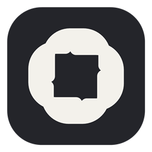
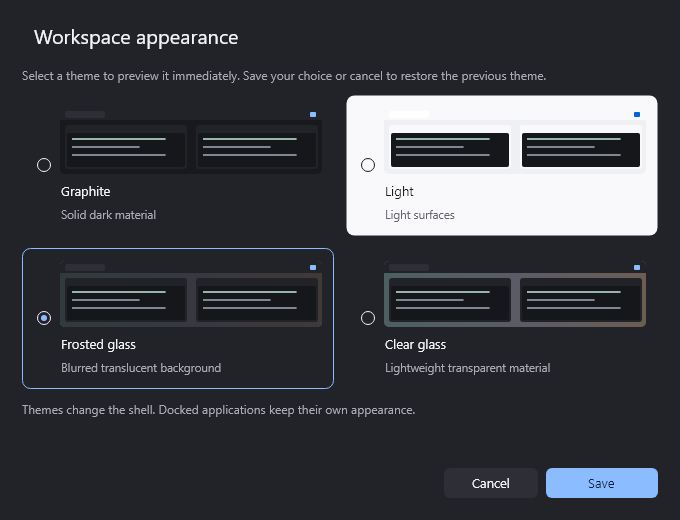

<div align="center">
  
  <h1>WindowDock</h1>
  <p><strong>Your windows. One workspace.</strong></p>
  <p>Bring independent terminals, AI agents, and desktop apps into compact, named tabs.</p>

  [](https://github.com/poikilometis/WindowDock/actions/workflows/ci.yml)
  [](https://github.com/poikilometis/WindowDock/actions/workflows/release.yml)
  [](https://github.com/poikilometis/WindowDock/releases)
  [](#requirements)
  [](#build-from-source)
  [](#architecture)
  [](#languages)
  [](LICENSE)

  [Download](https://github.com/poikilometis/WindowDock/releases/latest) · [Quick start](#quick-start) · [Documentation](#documentation) · [Report a bug](https://github.com/poikilometis/WindowDock/issues/new/choose)
</div>

---

WindowDock groups **existing application windows** into a single workspace. Keep several agent sessions visible, enlarge the one you are working with, and move or minimize the group together. Each application continues to run in its own process.

**Native window docking currently supports Windows x64.** The shared core and Avalonia interface are portable; Linux and macOS window backends are [planned](docs/ROADMAP.md).

## Why WindowDock?

- **Collect windows in one action.** Visible desktop windows fill the current tab; overflow creates more tabs automatically. Minimized windows are skipped.
- **Keep text readable.** Use a grid, one main window on the left, or two main windows on top. Adjust proportions, minimum panel sizes, and the per-tab limit from 1 to 25.
- **Focus without losing context.** Double-click a panel header to enlarge it inside its tab. Return to the grid with one click.
- **Organize freely.** Rename tabs and panels, drag to reorder or move across tabs, select several panels, search across workspaces, and undo supported actions.
- **Restore groups.** Reconnect windows that are still running after restarting WindowDock. Ambiguous matches wait for a manual assignment.
- **Automate capture.** Match application names and window titles, limit a rule to terminals, choose a destination tab, and add exclusions that take priority.
- **Launch project workspaces.** Save commands, arguments, working folders, and environment variables. Optional hooks report agent activity and permission requests.
- **Stay compact.** A 30-DIP command row and 22-DIP panel headers leave room for your applications. Hover scrolling routes the wheel without deliberately changing keyboard focus, where the target app supports it.

## Make it yours

Graphite, Light, Frosted glass, and Clear glass themes include a live preview. Give each tab a color, image, animated GIF, or transparent background. A visual picker supports HEX, RGB, HSV, and opacity. Background appearance does not change the docked application's own theme.

<p align="center">
  
</p>

## Quick start

1. Download the Windows x64 portable ZIP from [Releases](https://github.com/poikilometis/WindowDock/releases/latest).
2. Extract **the whole archive** into a folder you can write to, then run `WindowDock.exe`. Keep its runtime, language folders, and other files together.
3. Choose **Add windows** to pick applications, or **Collect windows** to distribute visible desktop windows across tabs.
4. Double-click a panel header to zoom it. Drag the header to change its position or move it to another tab.
5. Open **…** for layouts, appearance, capture rules, projects, integrations, and group restoration.

Closing WindowDock returns the docked windows to the desktop. It does not end their sessions. Back up the `data` folder before upgrading, close WindowDock, then replace the program files without overwriting your data.

### Requirements

- Windows x64 with a graphical desktop. The current build is exercised on Windows 11; compatibility with individual third-party apps varies.
- The portable distribution includes .NET 10. No separate .NET installation is needed to run that distribution.
- Run WindowDock and the applications you dock at matching privilege levels. Prefer a normal, non-administrator session.

<details>
<summary><strong>Shortcuts and mouse actions</strong></summary>

| Action | Shortcut |
| --- | --- |
| Switch to tabs 1–9 | `Ctrl + Alt + 1…9` |
| Zoom active panel / return | `Ctrl + Alt + Enter` |
| Add open windows | `Ctrl + Alt + A` |
| Search all workspaces | `Ctrl + Alt + K` |
| Undo | `Ctrl + Alt + Z` |
| Minimize / show group | `Ctrl + Alt + D` / `Ctrl + Alt + G` |
| New tab while the shell has focus | `Ctrl + N` |
| Search while the shell has focus | `Ctrl + K` |
| Cancel a drag or close a settings page | `Esc` |
| Zoom panel / return to grid | Double-click its header |
| Select multiple panels | `Ctrl` / `Shift` + click headers |

Global shortcuts can conflict with shortcuts registered by other programs.

</details>

## Languages

The interface follows your **OS display language at startup**. Unsupported languages fall back to English. Number and date formats continue to follow your regional preferences. Existing tab names, panel aliases, and project names are your data and are not translated.

| Language | Resource code | Examples |
| --- | --- | --- |
| English | `en` | `en-US`, `en-GB` |
| Русский | `ru` | `ru-RU` |
| Español | `es` | `es-ES`, `es-MX` |
| Tiếng Việt | `vi` | `vi-VN` |
| 繁體中文 · Traditional Chinese | `zh-Hant` | `zh-TW`, `zh-HK`, `zh-MO` |
| 简体中文 · Simplified Chinese | `zh-Hans` | `zh-CN`, `zh-SG` |
| ไทย | `th` | `th-TH` |
| 日本語 | `ja` | `ja-JP` |
| 한국어 | `ko` | `ko-KR` |
| Deutsch | `de` | `de-DE`, `de-CH` |
| Türkçe | `tr` | `tr-TR` |

For testing or a different display language, launch `WindowDock.exe --language de`, or set `WINDOWDOCK_LANGUAGE=de` before starting it. Restart WindowDock to apply a language change. See [translation instructions](docs/LOCALIZATION.md) to contribute corrections.

## Versioning

The public release series starts at **0.1.0**. New features advance `0.x.0`; compatible fixes advance `0.x.y`. Optional beta/RC suffixes identify test releases. See the [versioning policy](docs/VERSIONING.md) for compatibility and the separate Windows file counter.

## Agent integrations

WindowDock has project-scoped hook adapters for **Claude Code, Codex, and Gemini CLI**. From **… → Agent integrations**, choose a project folder and agents, preview the changes, then set them up. Existing hooks are preserved and owned changes are backed up. Restart the agent after setup.

**Codex hooks still require review and approval through `/hooks`.** WindowDock does not grant trust or change an agent's approval policy. Automatic hook setup can also run immediately before a command launched from **Projects**; opening or editing a project does not execute commands.

The integration keeps status and routing metadata, not prompt or response content. Agent versions and hook formats can change. See [integrations and manual status reporting](docs/AGENT-INTEGRATIONS.md).

## Builds and releases

Pushes and pull requests run CI across the shared core on Windows, Linux, and macOS, plus Windows native and localization checks. A matching version tag builds and publishes portable/source ZIPs with SHA-256 checksums and GitHub provenance attestations. See [publishing and delivery](docs/PUBLISHING.md).

## Build from source

Install the [.NET 10 SDK](https://dotnet.microsoft.com/download/dotnet/10.0), Git, and PowerShell. Package versions are centralized in `Directory.Packages.props`; `global.json` selects the .NET 10 SDK family.

```powershell
git clone https://github.com/poikilometis/WindowDock.git
cd WindowDock
.\build.ps1 -Test
```

To build a portable Windows distribution using the installed official .NET 10 runtime:

```powershell
.\build.ps1 -Publish -BundleInstalledRuntime -Test
```

Output: `dist/WindowDock/`. ZIP the **entire folder**, including hidden `.runtime`, when distributing it. The package includes its licenses and third-party notices. For a standard self-contained .NET publish, omit `-BundleInstalledRuntime`; restoring the runtime pack requires network access.

<details>
<summary><strong>Direct build and isolated test commands</strong></summary>

```powershell
dotnet restore WindowDock.sln
dotnet build WindowDock.sln -c Release --no-restore
dotnet run --project tests/WindowDock.Tests -c Release --no-build --no-restore
.\src\WindowDock.Desktop\bin\Release\net10.0\WindowDock.exe --self-test
```

The core suite covers layouts, persistence, group restore, rules, hooks, IPC, and localization. The Windows desktop suite creates its own disposable fixture applications and isolated profile. Reports and screenshots go to `artifacts/`. Use an interactive Windows desktop for native tests.

For manual UI testing without your regular workspace:

```powershell
.\src\WindowDock.Desktop\bin\Release\net10.0\WindowDock.exe --data-dir .\artifacts\manual-profile --language en
```

</details>

## Architecture

| Project | Responsibility |
| --- | --- |
| `WindowDock.Core` | Workspace model, layouts, rules, persistence, project launch, agent routing, translations |
| `WindowDock.Platform.Windows` | Win32 window ownership, placement, clipping, focus, hover scroll, global shortcuts, recovery |
| `WindowDock.Desktop` | Avalonia shell, panels, dialogs, themes, backgrounds, native integration tests |
| `WindowDock.Tests` | Dependency-free executable test suite for the shared core |

The current stack is **.NET 10 LTS, C# 14, and Avalonia 12.1.6**. This codebase uses neither Windows Forms nor .NET Framework.

## Limits and recovery

Some elevated, protected, exclusive fullscreen, unusual GPU-rendered, or DPI-incompatible windows cannot be embedded reliably. Menus, IME, popups, focus, and scrolling remain dependent on the host OS and target application. WindowDock is not a terminal emulator and cannot recreate the contents of a terminated terminal session.

Group restoration reconnects **existing** windows; it does not automatically relaunch saved commands. Normal shutdown restores native window state. A local recovery journal and guardian process attempt restoration after an unexpected exit; the next startup also checks for orphaned windows. Keep the application folder and `data` available during recovery.

## Data and privacy

Settings, saved groups, backups, and recovery journals are stored locally in `data/` beside the portable app. `--data-dir <folder>` or `WINDOWDOCK_DATA_DIR` selects a separate profile. Local agent communication uses named pipes; a Windows message route is also supported. WindowDock includes no telemetry or cloud account requirement.

Project commands, environment variables, window titles, and paths can be sensitive. Review diagnostic files before sharing them. Do not upload your `data/` directory or private agent configuration. See [security reporting](SECURITY.md).

## Documentation

[Agent integrations](docs/AGENT-INTEGRATIONS.md) · [Translations](docs/LOCALIZATION.md) · [Performance notes](OPTIMIZATION.md) · [Roadmap](docs/ROADMAP.md) · [Versioning](docs/VERSIONING.md) · [Changelog](docs/CHANGELOG.md) · [Contributing](CONTRIBUTING.md)

## Contributing

Bug reports, compatibility findings, translations, and focused pull requests are welcome. Start with [CONTRIBUTING.md](CONTRIBUTING.md) for the development workflow, native-window testing expectations, and how to keep private workspace data out of a contribution.

## License

WindowDock is available under the [MIT License](LICENSE). Bundled dependencies retain their own licenses; packaged builds include `THIRD-PARTY-NOTICES.txt` and the official .NET runtime notices.